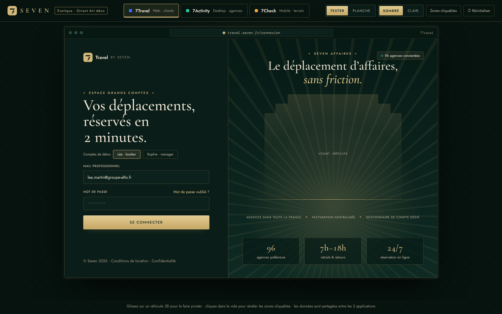
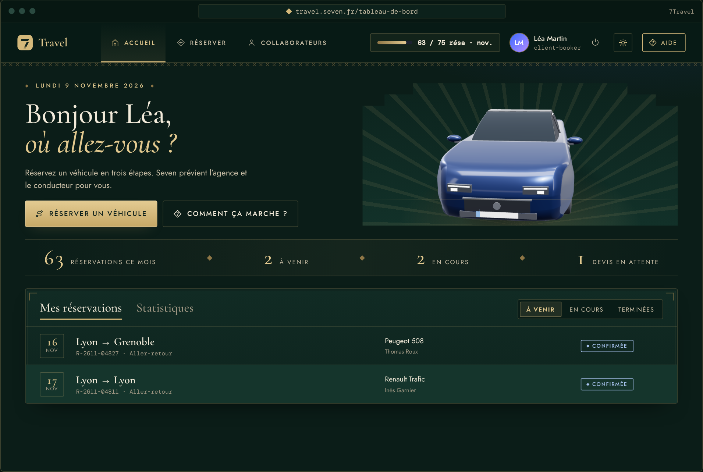
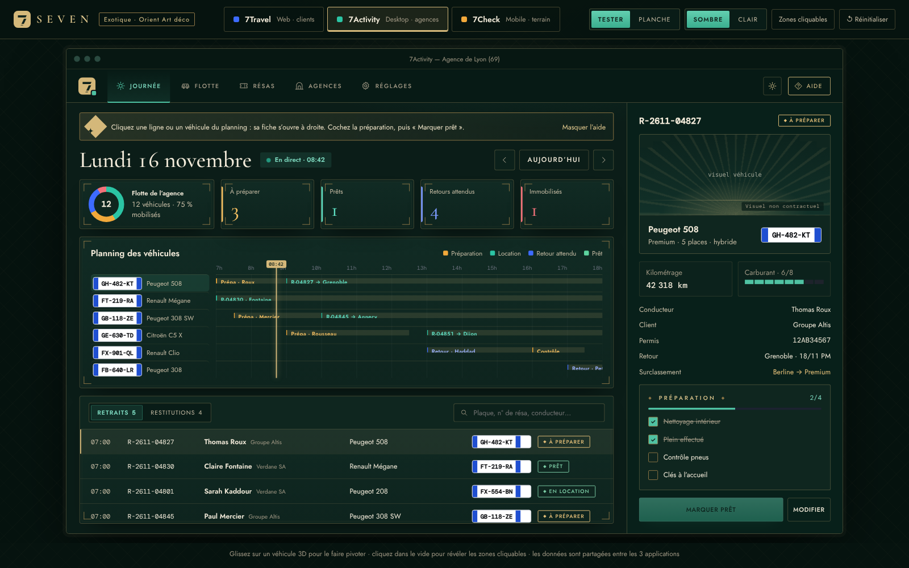
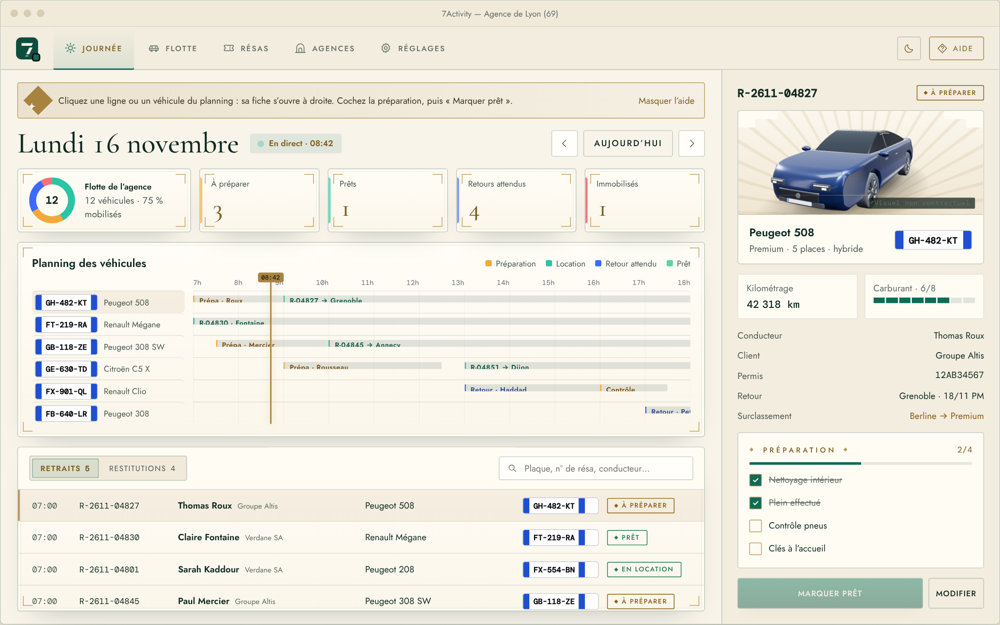
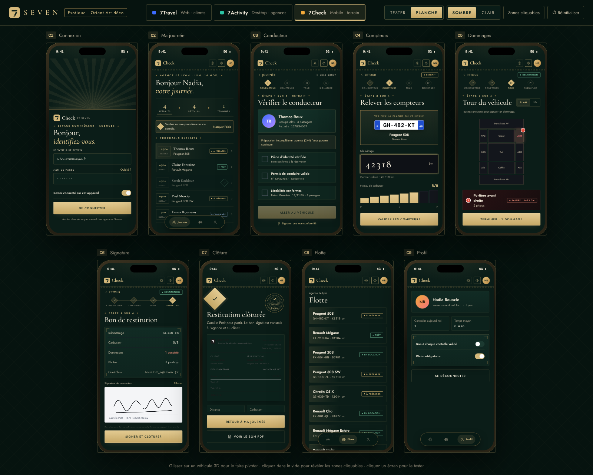

# Seven — Maquettes interactives (Orient Art déco)

Maquette interactive de **Seven**, un service de location de véhicules pour les déplacements professionnels, réalisée dans le cadre de mon **BTS SIO option SLAM**.

Le projet se compose de **3 applications** qui partagent les mêmes données :

| Application | Plateforme | Public | Rôle |
|---|---|---|---|
| **7Travel** | Web | Clients grands comptes | Réserver un véhicule en 3 étapes (trajet, véhicule, conducteur) |
| **7Activity** | Desktop | Agences | Planning de la journée, flotte, préparation des véhicules |
| **7Check** | Mobile | Contrôleurs terrain | Contrôle au retrait et à la restitution (conducteur, compteurs, tour du véhicule, signature) |

## Aperçu

### 7Travel (web)

### 7Activity (desktop), modes sombre et clair

### 7Check (mobile), parcours complet en 9 écrans

## Contexte

Maquette produite pour un projet du BTS SIO SLAM : concevoir l'expérience de bout en bout d'un loueur de véhicules (réservation, préparation en agence, contrôle sur le terrain) avant tout développement.

- Direction artistique **Art déco** (vert profond et or), thèmes sombre et clair
- Parcours testables : connexion, réservation, préparation d'un véhicule, contrôle en 4 étapes
- Données de démonstration cohérentes entre les 3 applications (mêmes réservations, mêmes véhicules)
- Aides contextuelles pour guider l'utilisateur à chaque écran

## Utilisation

Ouvrir `maquette/seven-mockup.html` dans un navigateur (connexion internet requise pour le visuel 3D du véhicule, qui charge three.js).

Comptes de démonstration : Léa (booker) et Sophie (manager) pour 7Travel, Nadia (contrôleuse) pour 7Check.

## Technologies

HTML, CSS et JavaScript (maquette autonome), three.js pour le visuel 3D.

## Auteur

Mathis Quideau — étudiant en BTS SIO SLAM, [LinkedIn](https://www.linkedin.com/in/mathis-quideau-abb09141a/)
